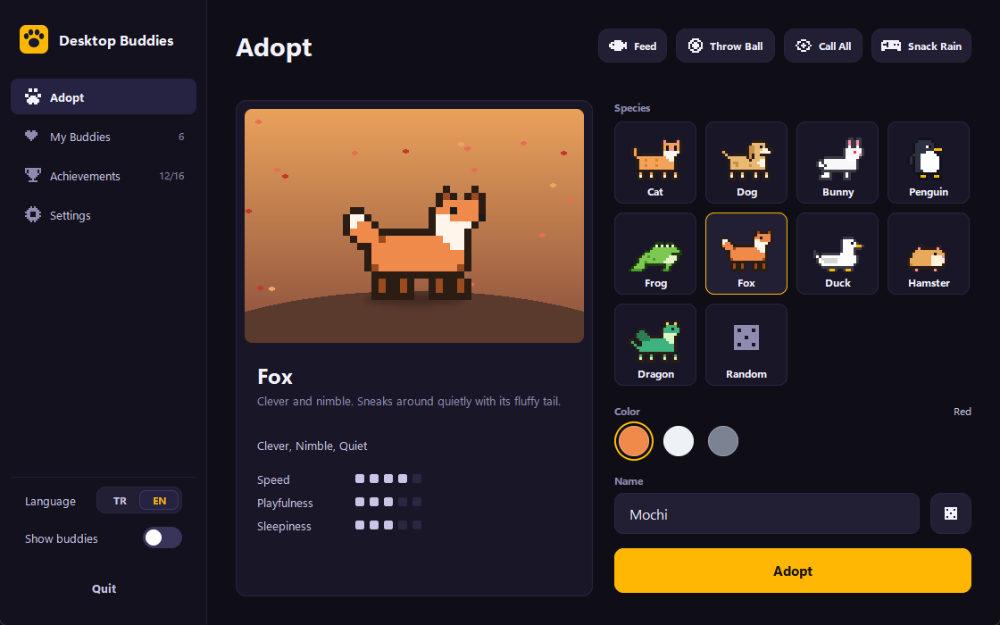
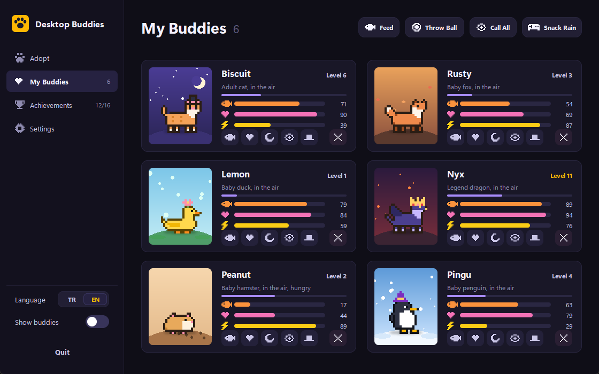
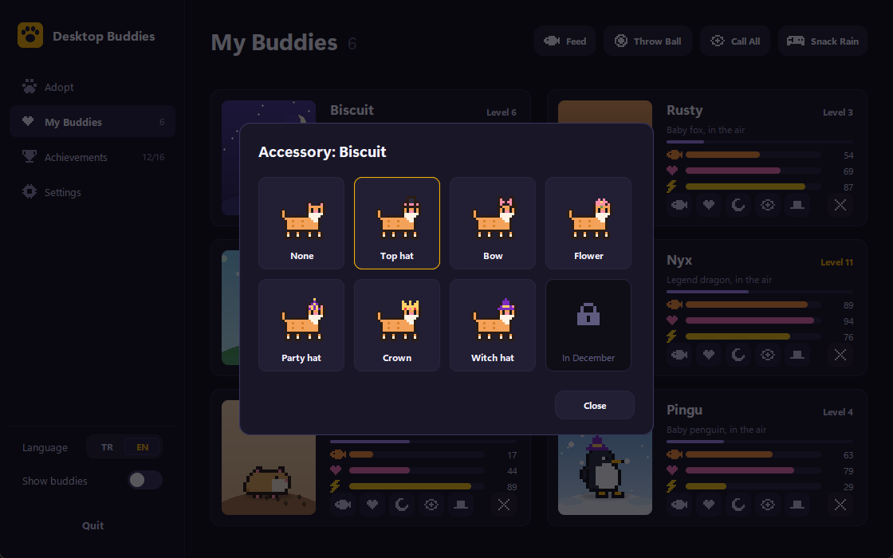
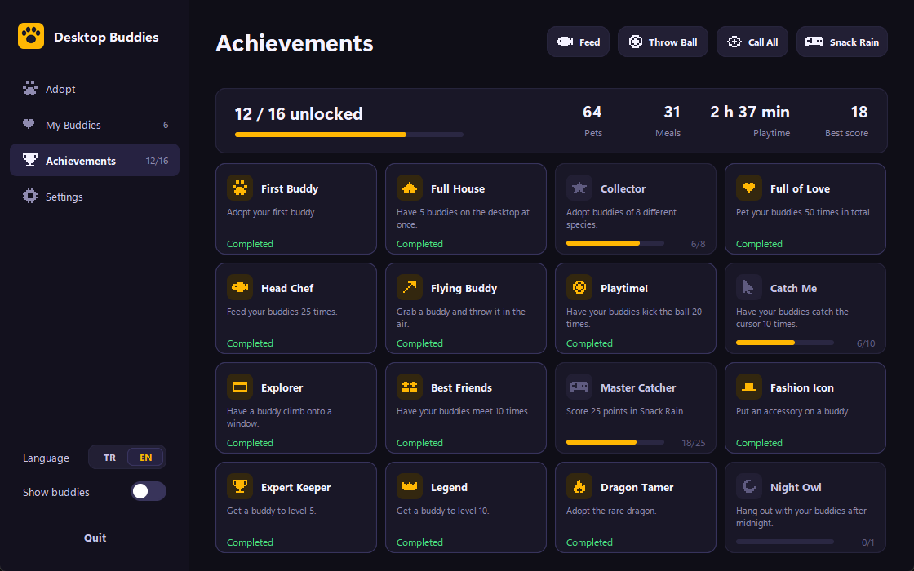

# Desktop Buddies

[Türkçe](README.md)

Tiny pixel art pets that live on your Windows desktop. They walk along the taskbar, climb on top of open windows, play with each other, get hungry and fall asleep. The more you care for them, the more they grow, level up and unlock new accessories.


## Features

- 9 species: cat, dog, bunny, penguin, frog, fox, duck, hamster and a rare dragon unlocked with 8 achievements. 30 colors in total.
- Every buddy has hunger, happiness and energy. Time passes while the app is closed, too.
- They grow as they level up: baby at level 1, adult at 5, legend at 10.
- Accessories unlocked by levels and achievements: top hat, bow, flower, party hat, crown. A witch hat in October and a Santa hat in December.
- Buddies greet each other, play chase or nap side by side when they meet. Best friends are remembered.
- Snack Rain: a 30-second mini game where you steer your buddy with the mouse to catch falling snacks.
- They can walk along the top edge of open windows. Move the window and they ride along; close it and they fall.
- Seasonal effects: snow, falling leaves or petals, and fireflies on summer nights.
- Multi-monitor support.
- 16 achievements, stats, speech bubbles and a ball toy.
- Turkish and English UI, update notifications, tray menu, start with Windows.

## Screenshots

| Adopt | My Buddies |
|---|---|
|  |  |

| Accessories | Achievements |
|---|---|
|  |  |

## Install

The easiest way is to download `MasaustuDostlari.exe` from the [Releases](../../releases) page. No installer or Python needed. Since it isn't signed, Windows SmartScreen may warn you: click "More info" and then "Run anyway". Switch the language to English from the bottom of the sidebar.

To run from source you need Python 3.10 or newer:

```
pip install -r requirements.txt
pythonw main.pyw
```

To build the exe yourself:

```
pip install -r requirements.txt pyinstaller
python build.py
```

The output is `dist/MasaustuDostlari.exe`. Pushing a tag that starts with `v` makes GitHub Actions build the exe and attach it to a release.

## Usage

- Left click: pet
- Drag and drop: move; let go quickly to throw
- Right click: the buddy's menu (feed, throw ball, sleep, accessory, mini game, remove...)
- Paw icon in the tray: main window; right click for a quick menu
- Closing the main window keeps the app running in the tray

## Data

Everything is stored in `%APPDATA%\MasaustuDostlari\hayvanlar.json`. Delete that folder to start over. The update check only reads the latest version number from GitHub and sends nothing else; it can be turned off in Settings.

## License

MIT
