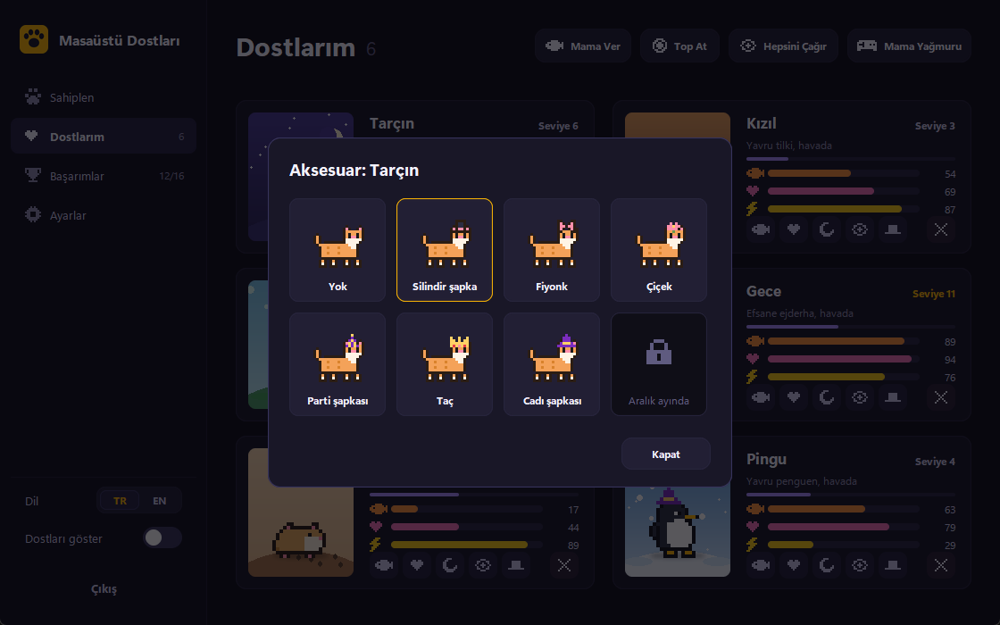

# Masaüstü Dostları

[English](README.en.md)

Windows masaüstünde yaşayan küçük piksel art hayvanlar. Görev çubuğunun üstünde gezerler, açık pencerelerin tepesine çıkarlar, birbirleriyle oynarlar, acıkır ve uyurlar. Onlarla ilgilendikçe büyür, seviye atlar ve yeni aksesuarların kilidini açarlar.


## Özellikler

- 9 tür: kedi, köpek, tavşan, penguen, kurbağa, tilki, ördek, hamster ve 8 başarımla açılan nadir ejderha. Toplam 30 renk.
- Her dostun tokluk, mutluluk ve enerji değeri var. Uygulama kapalıyken geçen süre de hesaba katılır.
- Seviye atladıkça büyürler: 1. seviyede yavru, 5'te yetişkin, 10'da efsane.
- Seviye ve başarımlarla açılan aksesuarlar: silindir şapka, fiyonk, çiçek, parti şapkası, taç. Ekim'de cadı, Aralık'ta Noel şapkası.
- Dostlar karşılaşınca selamlaşır, birbirini kovalar ya da yan yana uyur. En iyi arkadaşları kayıt altında.
- Mama Yağmuru: dostunu fareyle yönetip yukarıdan düşen mamaları yakaladığın 30 saniyelik mini oyun.
- Açık pencerelerin üst kenarında yürüyebilirler. Pencere taşınırsa onlarla gider, kapanırsa düşerler.
- Mevsime göre ekranda kar, yaprak ya da çiçek yaprakları; yaz gecelerinde ateşböcekleri.
- Birden fazla monitörde gezerler.
- 16 başarım, istatistikler, konuşma balonları, top oyuncağı.
- Türkçe ve İngilizce arayüz, yeni sürüm bildirimi, sistem tepsisi menüsü, Windows ile başlatma.

## Ekran görüntüleri

| Sahiplen | Dostlarım |
|---|---|
|  |  |

| Aksesuarlar | Başarımlar |
|---|---|
|  |  |


## Kurulum

En kolayı [Releases](../../releases) sayfasından `MasaustuDostlari.exe` dosyasını indirmek. Kurulum ya da Python gerekmez. İmzasız olduğu için Windows SmartScreen uyarı verebilir: "Ek bilgi" ve ardından "Yine de çalıştır".

Kaynaktan çalıştırmak için Python 3.10 veya üstü gerekir:

```
pip install -r requirements.txt
pythonw main.pyw
```

Exe'yi kendin derlemek istersen:

```
pip install -r requirements.txt pyinstaller
python build.py
```

Çıktı `dist/MasaustuDostlari.exe` olur. `v` ile başlayan bir etiket gönderildiğinde GitHub Actions exe'yi derleyip Releases'a ekler.

## Kullanım

- Sol tık: sev
- Sürükle bırak: taşı; hızlı bırakırsan fırlar
- Sağ tık: dostun menüsü (besle, top at, uyut, aksesuar, mini oyun, kaldır...)
- Tepsideki pati ikonu: ana pencere; sağ tıkla hızlı menü
- Ana pencereyi kapatmak uygulamayı kapatmaz, tepsiye küçültür

## Proje yapısı

```
main.pyw                giriş noktası
build.py                PyInstaller ile exe derleme
dostlar/
  app.py                ana döngü, tepsi, olaylar, güncelleme denetimi
  hub.py                ana pencere
  desktop.py            masaüstündeki dostlar, mama, top, balonlar
  games.py              Mama Yağmuru mini oyunu
  seasons.py            mevsim efektleri
  sprites.py            piksel art, türler, renkler, aksesuarlar
  gfx.py                Pillow ile çizim yardımcıları
  store.py              kayıt, istatistikler, başarımlar
  i18n.py               Türkçe / İngilizce metinler
  winapi.py             DPI, monitörler, pencere algılama, otomatik başlatma
tools/
  readme_assets.py      README görsellerini üretir
  check_i18n.py         eksik İngilizce çevirileri bulur
```

## Yeni tür eklemek

`dostlar/sprites.py` içinde 20x16 piksellik kareleri (`walk1`, `walk2`, `blink`, `happy`, `dangle`, `sleep`) çizip `SPECIES` sözlüğüne ekle, İngilizce metinlerini `SPECIES_EN` sözlüğüne yaz ve anahtarı `SPECIES_ORDER` listesine koy. `hat` değeri aksesuarların kafada nereye oturacağını belirler. Önizleme sahnesi için `dostlar/gfx.py` içindeki `STAGES` sözlüğüne bir satır eklemek yeterli.

Harfler: `K` çizgi, `O` ana renk, `D` koyu ton, `W` açık ton, `E` göz, `P` pembe, `Y` gaga/ayak/boynuz.

Yeni bir metin eklediğinde `python tools/check_i18n.py` eksik İngilizce çevirileri listeler.

## Veriler

Her şey `%APPDATA%\MasaustuDostlari\hayvanlar.json` dosyasında tutulur. Sıfırdan başlamak için bu klasörü silmek yeterli. Güncelleme denetimi yalnızca GitHub'daki son sürüm numarasını okur, başka bir veri göndermez; ayarlardan kapatılabilir.

## Lisans

MIT
