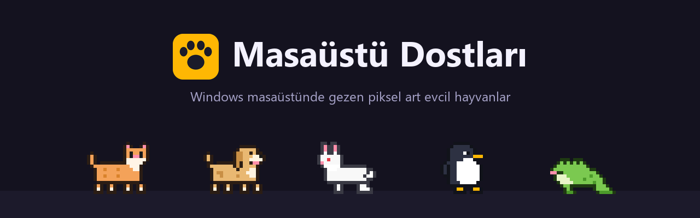
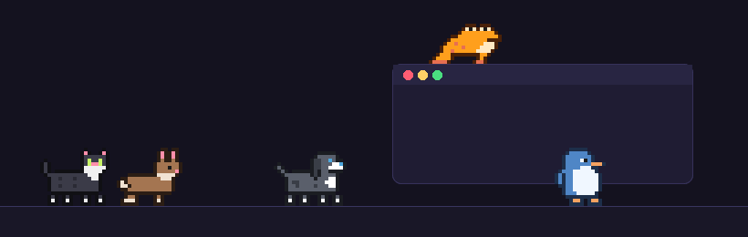
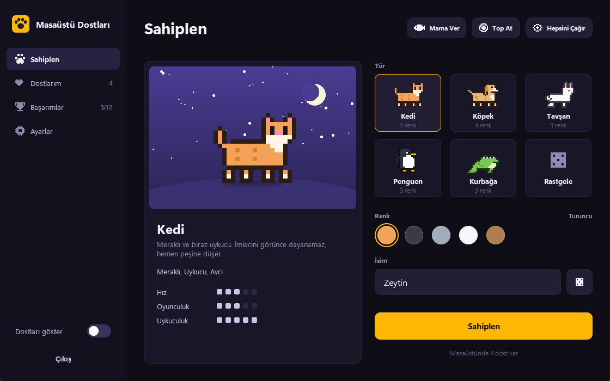
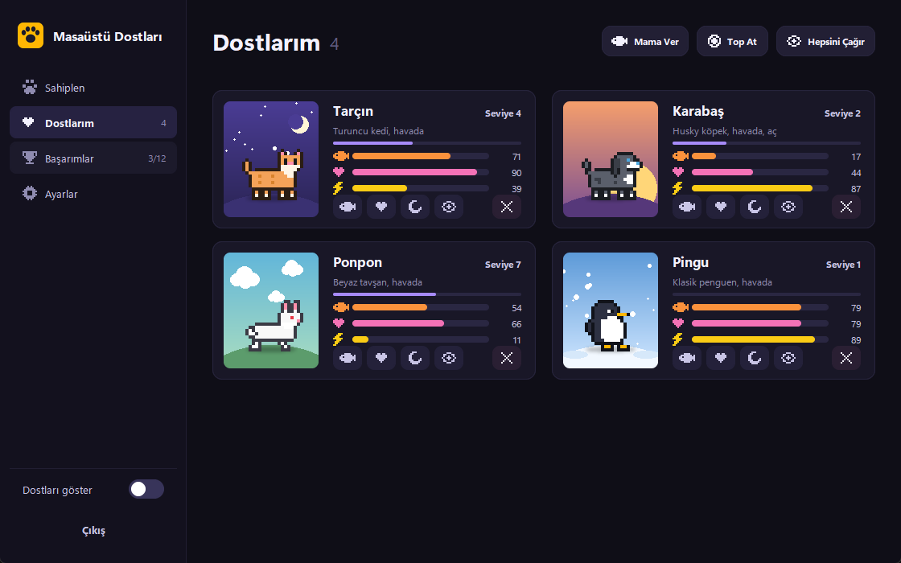
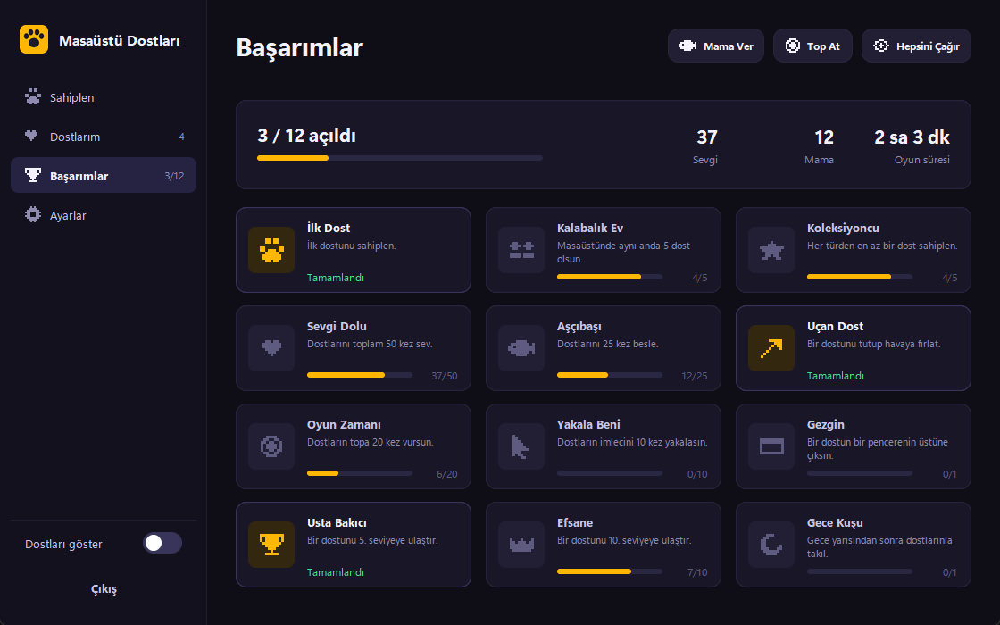
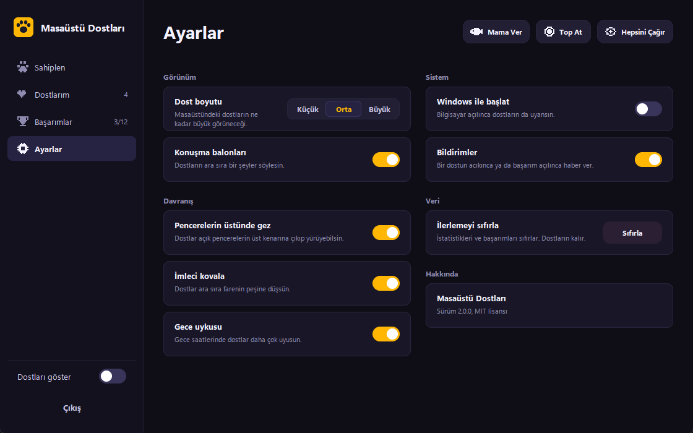
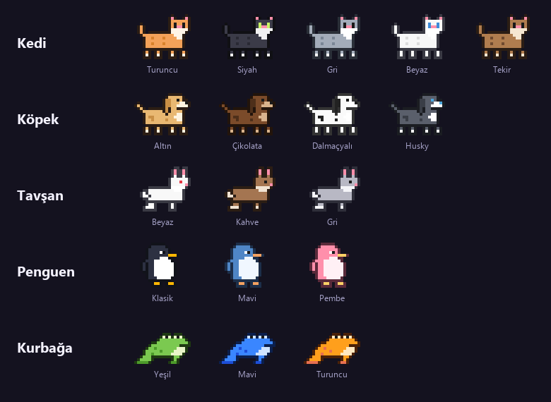

# Masaüstü Dostları

Windows masaüstünde yaşayan küçük piksel art hayvanlar. Görev çubuğunun üstünde gezerler, açık pencerelerin tepesine çıkarlar, imleci kovalarlar, acıkır ve uyurlar. Onlarla ilgilendikçe seviye atlarlar.



## Özellikler

- 5 tür (kedi, köpek, tavşan, penguen, kurbağa) ve toplam 18 renk. Tavşan ve kurbağa zıplayarak, penguen yavaş yürür.
- Her dostun tokluk, mutluluk ve enerji değeri var. Uygulama kapalıyken geçen süre de hesaba katılır.
- Sevmek, beslemek ve oynamak XP kazandırır; dostlar seviye atlar.
- 12 başarım ve basit istatistikler.
- Dostlar açık pencerelerin üst kenarında yürüyebilir. Pencere taşınırsa onlarla birlikte gider, kapanırsa aşağı düşerler.
- Masaüstüne mama ya da top bırakılabilir.
- Ara sıra konuşma balonuyla bir şeyler söylerler.
- Sistem tepsisinden açma, gizleme ve hızlı eylemler.
- Ayarlar: boyut, konuşma balonları, pencerelerde gezme, imleci kovalama, gece uykusu, bildirimler, Windows ile başlatma.

## Ekran görüntüleri

| Sahiplen | Dostlarım |
|---|---|
|  |  |

| Başarımlar | Ayarlar |
|---|---|
|  |  |



## Kurulum

En kolayı [Releases](../../releases) sayfasından `MasaustuDostlari.exe` dosyasını indirmek. Kurulum ya da Python gerekmez. İmzasız olduğu için Windows SmartScreen uyarı verebilir: "Ek bilgi" ve ardından "Yine de çalıştır".

Kaynaktan çalıştırmak için Python 3.10 veya üstü gerekir:

```
pip install -r requirements.txt
pythonw main.pyw
```

Exe'yi kendin derlemek istersen:

```
pip install -r requirements.txt pyinstaller
python build.py
```

Çıktı `dist/MasaustuDostlari.exe` olur. `v` ile başlayan bir etiket gönderildiğinde GitHub Actions exe'yi derleyip Releases'a ekler.

## Kullanım

- Sol tık: sev
- Sürükle bırak: taşı; hızlı bırakırsan fırlar
- Sağ tık: dostun menüsü (besle, top at, uyut, kaldır...)
- Tepsideki pati ikonu: ana pencere; sağ tıkla hızlı menü
- Ana pencereyi kapatmak uygulamayı kapatmaz, tepsiye küçültür

## Proje yapısı

```
main.pyw              giriş noktası
build.py              PyInstaller ile exe derleme
dostlar/
  app.py              ana döngü, tepsi, olaylar
  hub.py              ana pencere
  desktop.py          masaüstündeki dostlar, mama, top, balonlar
  sprites.py          piksel art, türler, renkler
  gfx.py              Pillow ile çizim yardımcıları
  store.py            kayıt, istatistikler, başarımlar
  winapi.py           DPI, pencere algılama, otomatik başlatma
tools/readme_assets.py  README görsellerini üretir
```

## Yeni tür eklemek

`dostlar/sprites.py` içinde 20x16 piksellik kareleri (`walk1`, `walk2`, `blink`, `happy`, `dangle`, `sleep`) çizip `SPECIES` sözlüğüne ekle, anahtarı `SPECIES_ORDER` listesine yaz. Önizleme sahnesi için `dostlar/gfx.py` içindeki `STAGES` sözlüğüne bir satır eklemek yeterli.

Harfler: `K` çizgi, `O` ana renk, `D` koyu ton, `W` açık ton, `E` göz, `P` pembe, `Y` gaga/ayak.

## Veriler

Her şey `%APPDATA%\MasaustuDostlari\hayvanlar.json` dosyasında tutulur. Sıfırdan başlamak için bu klasörü silmek yeterli.

## Lisans

MIT
